# 专辑封面视觉特效设计

> 专辑封面与音频可视化最有意思的结合，不是简单地把频谱画在封面上，而是让封面成为整个视觉世界的核心：音乐驱动这个世界产生呼吸、流动、变形、爆发和空间感。
>
> 本文定义一套**可组合的封面视觉特效系统**：封面提供视觉素材，FFT / Bass / Beat 驱动动画，GPU / Canvas 负责实时渲染。目标是既做出有辨识度的效果，也方便后续由 AI Code Agent 持续增加特效。
>
> 配套文档：
>
> - [audio-analysis-stream.md](audio-analysis-stream.md) — C++ 播放端如何产出音频分析帧
> - [beat-detection.md](beat-detection.md) — Beat / 低频起音 / 低频节奏特征与算法
> - [web-console/audio-visualization-engine.md](web-console/audio-visualization-engine.md) — Web Visualizer 协议与插件架构
> - [mplayer-engine.md](mplayer-engine.md) — 播放核与引擎侧分析接口
>
> 桌面端现有实现起点：`MPlayerUI/AlbumArtVisualizerCtrl`（圆形封面 + 径向频谱 + 封面取色）。多特效拆分与切换见 [album-art-visualizer-architecture.md](album-art-visualizer-architecture.md)。

---

## 1. 设计原则

```text
Album Art  ──►  视觉素材（纹理、颜色、形状）
FFT/Bass/Beat ──►  运动驱动（呼吸、冲击、形变）
GPU/Canvas ──►  实时渲染（图层合成）
```

三条约束：

1. **封面是主角**，频谱与粒子是围绕封面展开的氛围，而不是反过来。
2. **音频分析与渲染解耦**：渲染层只消费统一的 `AudioAnalysisFrame`，不直接碰 FFT。
3. **特效按图层组合**，不为每种风格单独写一套完整渲染器；后续加效果时复用取色、平滑、Shader 参数系统。

---

## 2. 最值得做的 8 种视觉特效

### 2.1 音乐能量核心 · Audio Reactor（首推）

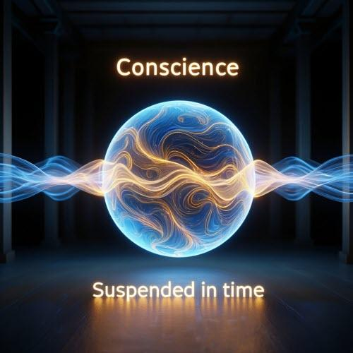

封面悬浮在画面中央，外面包裹多层发光圆环、粒子轨道和能量波。

| 驱动 | 效果 |
| --- | --- |
| Bass | 核心呼吸：膨胀与收缩 |
| FFT 频段 | 不同环形的振幅与形变 |
| Beat | 冲击波、闪光、粒子喷发 |
| 封面边缘 | 随音乐跳动的折射光 |

视觉风格：科幻、沉浸式、电子音乐现场。最适合作为播放器的标志性效果。

### 2.2 封面液态呼吸 · Living Artwork

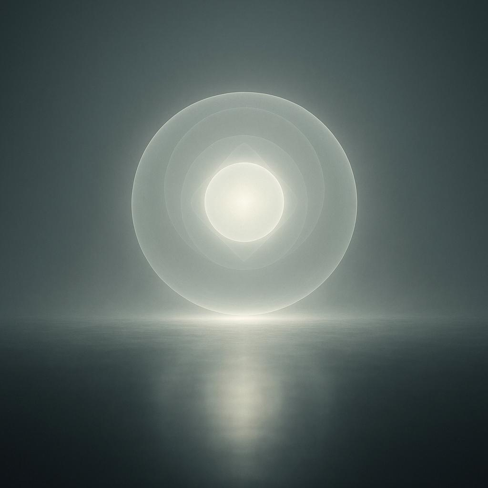

专辑封面不再是静止图片，而像一幅活着的画。颜色从封面中缓慢流出，背景随音乐能量改变形态。

| 驱动 | 效果 |
| --- | --- |
| 低频 | 封面轻微膨胀，像在呼吸 |
| 中高频 | 边缘液态波纹 |
| 高潮（高能量） | 流体扭曲 |
| 暂停 | 画面缓慢恢复静止 |

视觉风格：高级、艺术化，适合 Ambient、Jazz、Lo-fi。实现成本相对低，适合默认全屏听歌界面。

### 2.3 封面空间隧道 · Infinite Tunnel

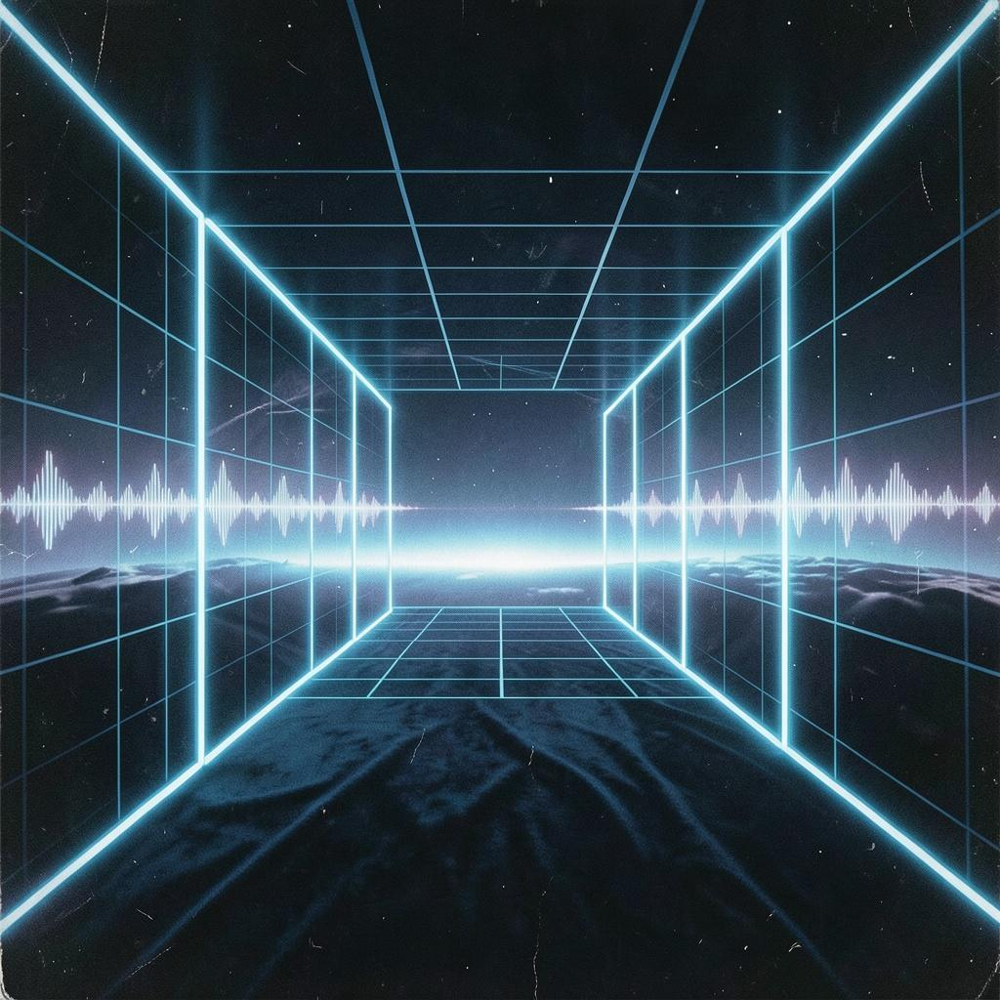

把封面变成通往另一个空间的入口，周围形成无限延伸的隧道、镜面或重复的封面阵列。

| 驱动 | 效果 |
| --- | --- |
| Beat | 镜头向前冲刺 |
| Bass | 空间深度与隧道宽度 |
| 高频 | 隧道表面的细密光线 |
| 切歌 | 旧封面碎裂，新封面从远处靠近 |

视觉风格：沉浸式、迷幻，适合全屏播放器。

### 2.4 水晶封面 · Prism Explosion

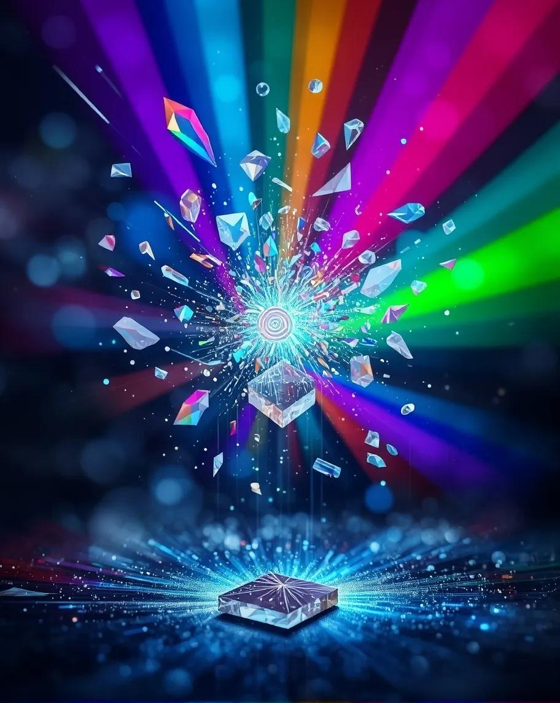

封面像一块玻璃或水晶，在音乐中发生折射、分裂和重组。

| 驱动 | 效果 |
| --- | --- |
| 高潮 | 封面短暂分裂成数百个碎片 |
| 碎片本身 | 不同角度的颜色折射 |
| Beat | 碎片向外爆炸，再聚合回封面 |
| 后处理 | 色散、Bloom、镜面反射 |

视觉风格：华丽、未来感强，适合 EDM、摇滚和高潮段落。

### 2.5 封面声纹 · Sonic Halo

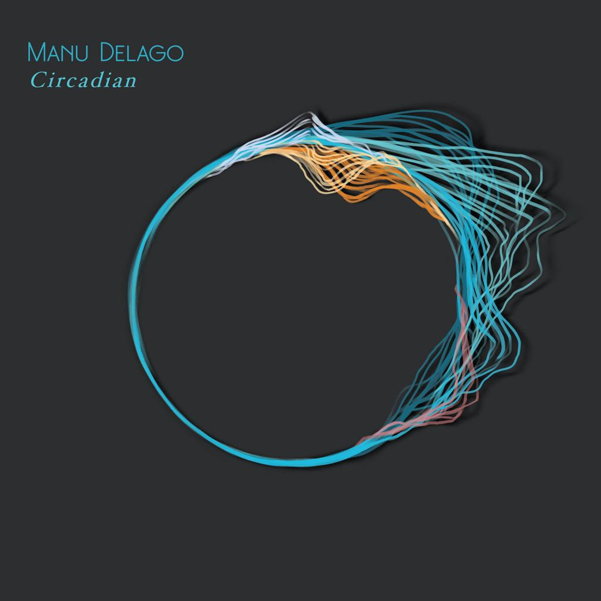

以封面为中心，生成精致的环形频谱、声纹和同心波阵列。它不是传统柱状频谱，而是精细的动态艺术图形。

| 驱动 | 效果 |
| --- | --- |
| 低频 | 外圈粗大波形 |
| 中频 | 主环起伏 |
| 高频 | 密集、细腻的光线 |
| 旋转 | 多个环采用不同方向与速度 |

视觉风格：极简、高级，适合桌面常驻和迷你播放器。桌面端 `AlbumArtVisualizer` 已接近这一方向的简化版。

### 2.6 封面星云 · Cosmic Dust

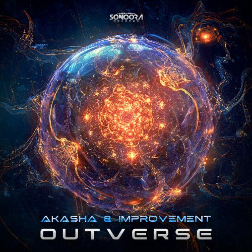

从专辑封面颜色中提取色彩，生成围绕封面运动的星尘、烟雾、微光和星云。

| 驱动 | 效果 |
| --- | --- |
| Bass | 粒子密度与扩散范围 |
| 高频 | 细粒子闪烁 |
| Beat | 向外扩散的星尘冲击波 |
| 切歌 | 粒子颜色渐变为新封面主色调 |

视觉风格：梦幻、空间感强，适合长时间欣赏音乐。

### 2.7 液态金属 · Liquid Chrome

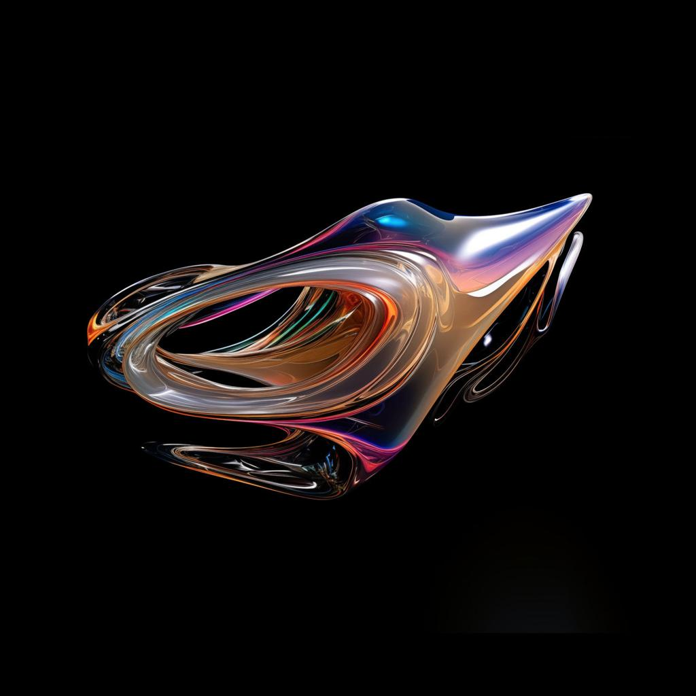

封面周围包裹流动的金属、镜面液体或彩色油膜，像音乐正在改变空间的物理规律。

| 驱动 | 效果 |
| --- | --- |
| 低频 | 金属表面波动幅度 |
| Beat | 液态金属脉冲与飞溅 |
| 高潮 | 镜面扭曲与彩色反射 |
| 封面 | 倒映在金属表面上，形成动态镜像 |

视觉风格：奢华、先锋，适合高端播放器的招牌效果。

### 2.8 音乐丝带 · Harmonic Ribbons

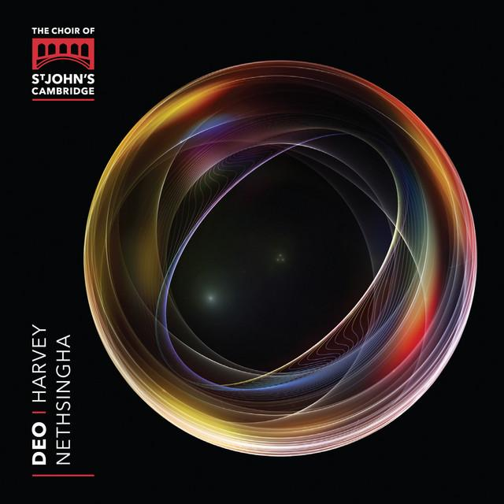

多条发光丝带从封面四周延伸出来，随不同频率弯曲、摆动和缠绕。

| 驱动 | 效果 |
| --- | --- |
| 低频 | 丝带整体摆幅 |
| 中频 | 曲线主要形态 |
| 高频 | 细节振动 |
| 声道 / 频段 | 不同颜色的丝带 |

视觉风格：优雅、流畅，适合古典、流行、电子音乐。

---

## 3. 真正让效果出众的 5 个设计技巧

### 3.1 从封面提取颜色，而不是固定使用主题色

每首歌自动生成自己的视觉调色板。

| 封面倾向 | 视觉方向 | 参考 |
| --- | --- | --- |
| 暖色 | 橙红色能量、熔岩、火花、暖金光晕 |  |
| 冷色 | 蓝紫色粒子、冰晶、星云、冷色光环 |  |
| 黑白 | 银色声纹、单色粒子、极简光线 | 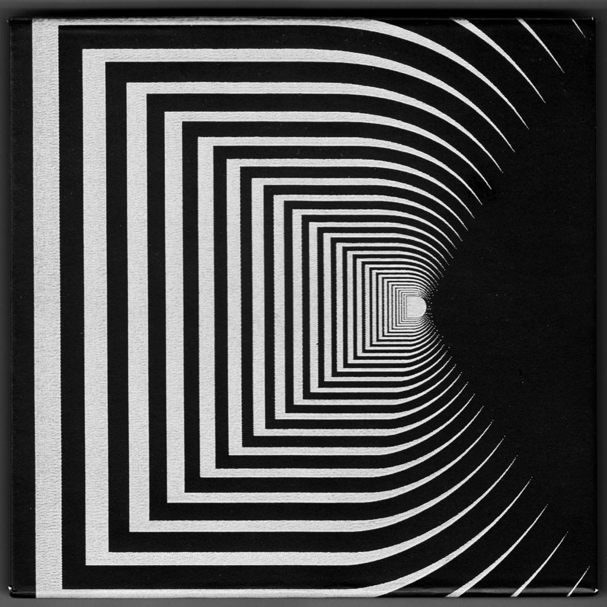 |
| 高饱和 | 彩虹色散、色彩拖影、全息折射 | 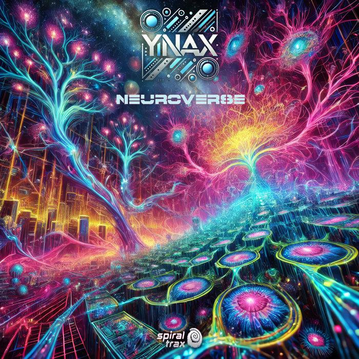 |

建议提取：

```ts
interface AlbumPalette {
  dominantColors: Color[];  // 2~5 个主色
  accentColor: Color;       // 高对比强调色
  backgroundColor: Color;   // 压暗后的背景底色
}
```

曲目切换时对调色板做插值，不要突然跳色。桌面端 `AlbumArtVisualizerCtrl::extractPalette` 已有基础取色，可演进为统一的 `AlbumPalette`。

### 3.2 背景使用封面本身，制造空间层次

这是成本很低、视觉提升却很大的技巧。

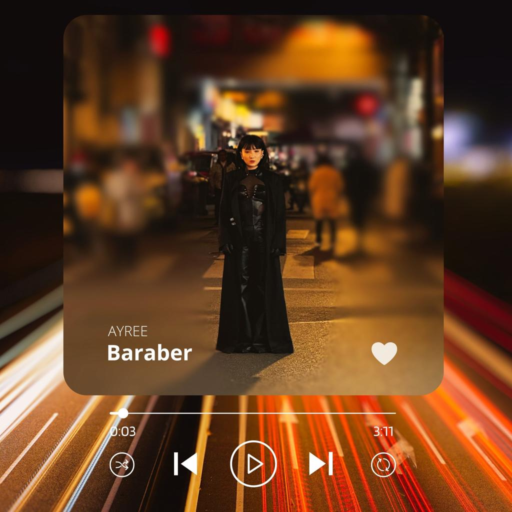
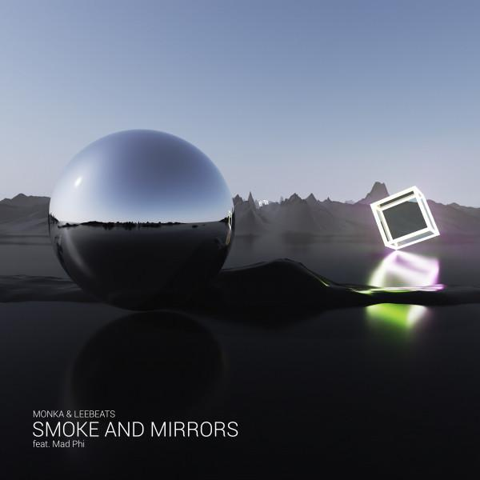
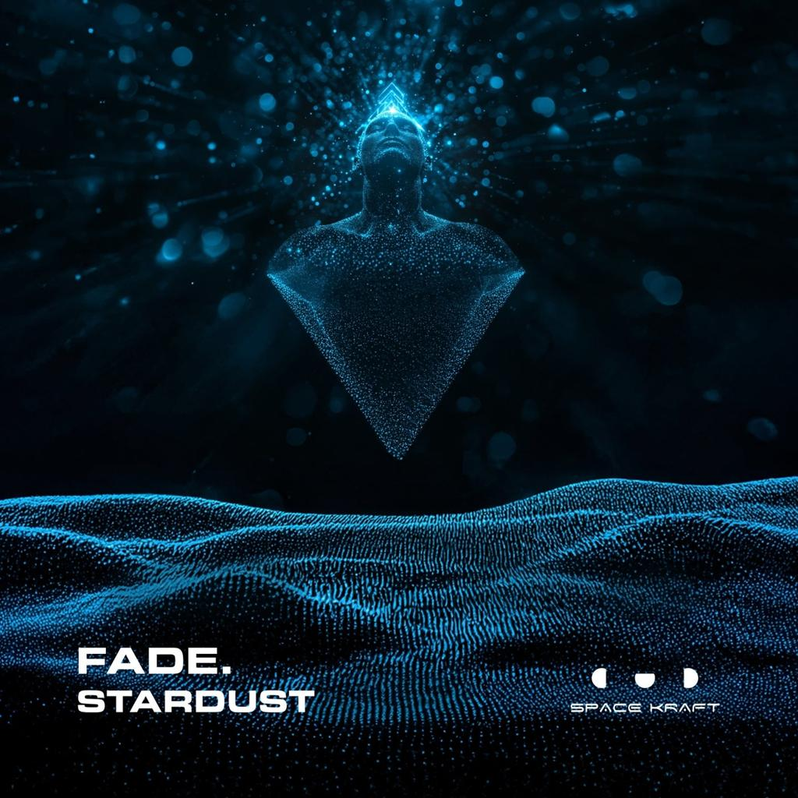

把同一张封面拆成多个视觉层：

| 图层 | 内容 |
| --- | --- |
| Background | 封面放大到全屏，模糊、压暗、降低饱和度 |
| Artwork | 清晰的原始封面，可带轻微 3D 倾斜 |
| Reflection | 镜像倒影或模糊的颜色反射 |
| Atmosphere | 封面主色形成的光晕、烟雾与粒子 |
| Reactive | 频谱环、冲击波、丝带等实时动画 |

即使不做复杂 3D 建模，也能形成明显的空间深度。

### 3.3 让不同频率控制不同物理属性

不要把所有频段简单映射到同一个 scale。统一音频特征输入建议如下：

| 音频特征 | 推荐驱动属性 |
| --- | --- |
| `lowEnergy`（低频持续能量） | 整体缩放、呼吸、光环厚度 |
| `bassPulse` / `bassStrength` / `lowOnset` | Bass 爆发、冲击波、封面缩放（仅低频 hit） |
| `lowOnsetStrength`（连续低频起音） | 调试 / 可选插值，不驱动冲击包络 |
| `beatPulse` / `beatStrength` | 通用打击闪光、描边（可含中频 Flux） |
| `onsetStrength`（全频起音 / Spectral Flux） | 踩镲等细振动、丝带亮度、突变感 |
| Mid / 中频能量 | 形变、波纹、丝带曲率 |
| Treble / 高频能量 | 粒子闪烁、细线、碎光 |
| RMS / 整体响度 | 全局亮度、光晕强度 |
| `bassRhythmRate` / `rhythmConfidence` | 环/轨道节奏感（慢更新） |

桌面实现：宿主 `CAlbumArtVisualizerCtrl` 平滑后写入 `AlbumArtVizContext`；`LivingCover` / `SonicHalo` / `AudioReactor` 按上表拆开消费，不再把所有冲击混进单一 `beat`。

**重要细节：音频数据必须先平滑，再驱动动画。**

推荐：

- Attack / Release 平滑（撑起快、回落慢）
- Beat 瞬态阈值与冷却时间
- 避免画面抖动，或每个鼓点都触发夸张效果

字段来源与平滑策略见 [audio-visualization-engine.md](web-console/audio-visualization-engine.md) §4–§7 与 [audio-analysis-stream.md](audio-analysis-stream.md)。

### 3.4 曲目切换要有完整的视觉过渡

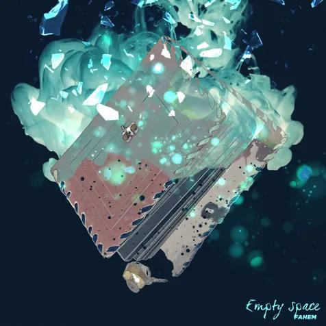
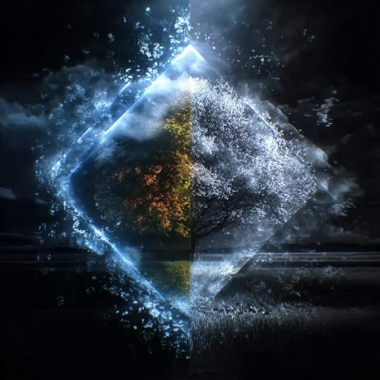
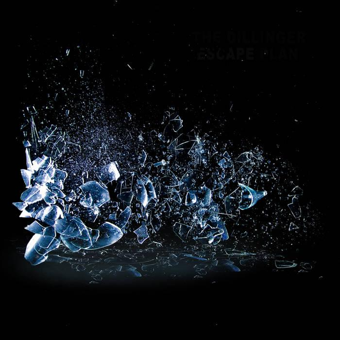

三种过渡：

| 名称 | 行为 |
| --- | --- |
| Dissolve | 旧封面溶解成粒子，新封面从粒子中聚合 |
| Portal | 旧封面向内收缩成光圈，新封面从光圈中出现 |
| Morph | 背景颜色、光晕与图形从旧曲目视觉状态平滑过渡到新曲目 |

切歌过渡约 **500–1000 ms**，按音乐风格与动画类型调整。无需每次切歌都触发强烈动画。

### 3.5 把特效设计成可组合的图层

不要为每种音乐风格分别开发一套完全独立的渲染器。更适合本播放器的做法是拆成独立 Layer，共享同一份 `AudioAnalysisFrame`：

```text
Atmosphere Layer
  背景模糊、色彩光晕、渐变

Artwork Layer
  封面、3D 变换、反射、液态形变

Reactive Layer
  FFT 频谱、光环、波纹、丝带

Particle / Post Layer
  粒子、Bloom、色散、拖影
```

每个图层各自维护动画状态，但输入协议统一。这样增加「水晶」「液态金属」「星云」「丝带」时，不必重新设计音频接口。

---

## 4. 结合本项目技术栈的实现建议

### 4.1 分析与渲染分离

本播放器已规划：C++ 播放核提取 FFT 等分析数据，经 LocalServer 传给 Web 前端（见 [audio-analysis-stream.md](audio-analysis-stream.md)）。封面特效系统建立在同一协议之上。

```text
C++ MPlayerEngine
      │
      ▼
AudioAnalysisFrame（Bass / Mid / Treble / RMS / Peak / Beat / 对数频段）
      │
      ├── 桌面 Skin：AlbumArtVisualizer / 后续 GPU 控件
      └── Web Console：Visualizer 插件 + Three.js / Canvas / CSS
```

### 4.2 渲染技术选型

| 技术 | 负责内容 |
| --- | --- |
| WebGL / Three.js | 3D 封面、空间隧道、粒子、液态效果 |
| WebGL Shader | 封面形变、波纹、色散、光晕 |
| Canvas 2D | 简单频谱、粒子、2D 丝带；桌面 Agg 也可承担同类职责 |
| CSS | 封面呼吸、旋转、模糊、渐变过渡（Web 轻量模式） |
| AudioAnalysisFrame | 向渲染层提供统一音频驱动数据 |

建议：

- **主方案**：Three.js + 自定义 Shader（全屏沉浸 / Web 全屏播放器）
- **轻量模式**：Canvas 2D 或 CSS（迷你播放器、低功耗）
- **桌面端**：先在现有 Agg + `AlbumArtVisualizer` 上增强 Sonic Halo / Living Cover；高阶 3D 效果优先在 Web 全屏验证，再决定是否引入桌面 GPU 路径

并不需要所有特效都上 Three.js：背景模糊、呼吸、渐变光晕用 CSS（Web）或简单后处理即可。

### 4.3 帧率与插值

| 端 | 频率 |
| --- | --- |
| 音频分析输出 | 约 30–50 Hz（平滑后的 64 对数频段 + Bass/Mid/Treble/RMS/Peak/Beat） |
| 渲染 | 目标 60 FPS |
| 渲染侧 | 对相邻分析帧插值，不必让 FFT 也跑到 60 Hz |

---

## 5. 优先实现的 3 个招牌效果

基础设施只做一次：封面取色、音频特征、平滑器、Shader / 图层参数。后续水晶、液态金属、星云、丝带都挂在同一套系统上。

### Phase A · Living Cover（第一阶段）

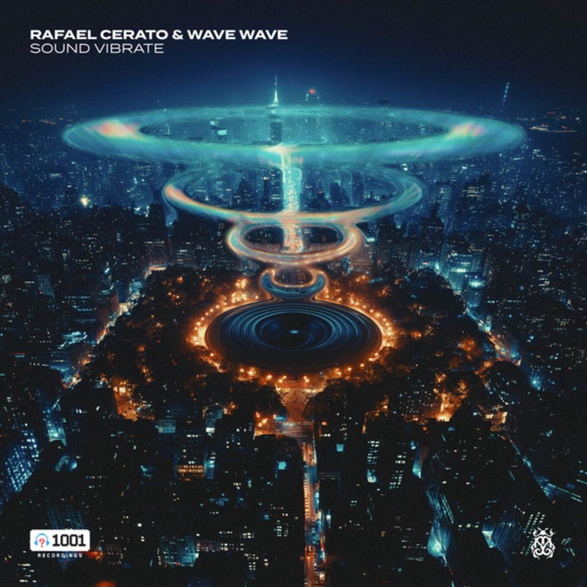

封面呼吸 + 动态光晕 + 柔和波纹 + 封面主色背景。

- 实现成本低
- 适合默认全屏播放界面
- 日常听歌不会太吵

### Phase B · Audio Reactor（第二阶段）


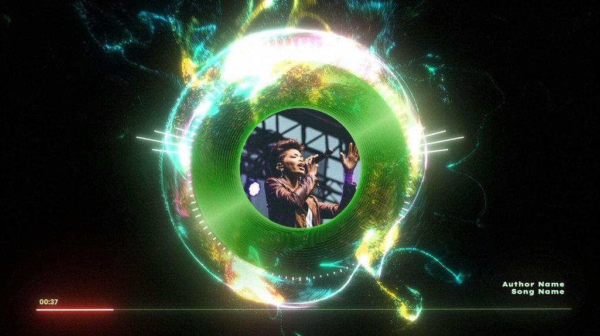

封面悬浮 + 黑胶刻线盘 + 厚发光反应环 + 径向频谱刻度 + 左右翼标 + 外围能量粒子/光带；Bass 驱动呼吸，Beat 触发粒子喷发。颜色从封面取色并抬饱和（霓虹感）。

- 最适合作为播放器标志性视觉效果
- 能直接利用现有 FFT 输出
- 桌面实现：`audio-reactor` 特效（`MPlayerUI/albumart-viz/effects/AudioReactorEffect`）

### Phase C · Infinite Universe（第三阶段）

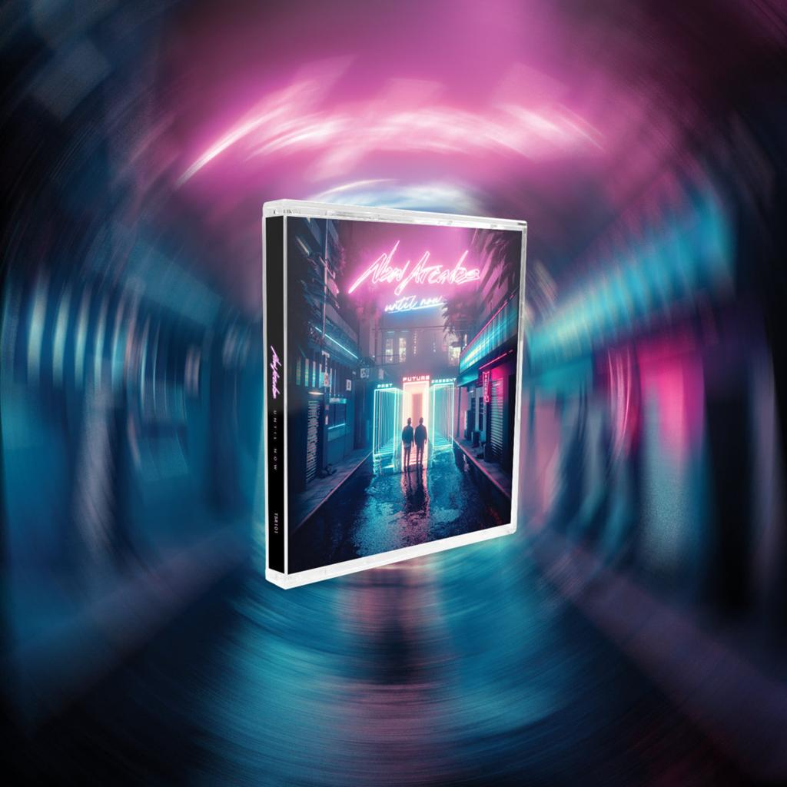

3D 空间 + 粒子 + 封面传送门 + 动态镜头。

- 用于全屏沉浸模式
- 重点追求空间感与视觉冲击
- 不必作为默认界面

### 路线图小结

```text
共享基础设施
  ├── AlbumPalette（封面取色 + 切歌插值）
  ├── AudioAnalysisFrame 消费与 Attack/Release 平滑
  ├── Layer 合成（Atmosphere / Artwork / Reactive / Post）
  └── 切歌过渡（Dissolve / Portal / Morph）

Phase A  Living Cover
Phase B  Audio Reactor   ← 标志性方向
Phase C  Infinite Universe
之后扩展  Prism / Cosmic Dust / Liquid Chrome / Ribbons …
```

如果只选一个最有潜力的方向：**Audio Reactor**——让专辑封面成为由音乐驱动的能量核心。它能同时体现封面本身的艺术风格和歌曲的实时动态，也很容易扩展成一套有辨识度的视觉主题。

---

## 6. 与现有代码的对应关系

| 能力 | 现状 | 演进方向 |
| --- | --- | --- |
| 音频分析帧 | `AudioAnalysisFrame` + `IAudioAnalysisSink`（播放核） | 保持协议稳定，特效只消费字段 |
| 桌面封面可视化 | `CAlbumArtVisualizerCtrl`：圆形封面、径向条、光环、取色、Beat flash | 增强为 Sonic Halo / Audio Reactor 的轻量桌面版 |
| 封面主色 | `extractPalette` / `rayColors` | 抽出统一 `AlbumPalette`，切歌插值 |
| Web Visualizer | 设计见 `audio-visualization-engine.md` | 以 Layer + Preset 实现 Phase A/B/C |
| 分析传输 | `audio-analysis-stream.md` | Web 全屏特效只收帧、不重算 FFT |

---

## 7. 给 AI Code Agent 的扩展约定

新增一个封面特效时，按这个清单实现，避免另起炉灶：

1. **只消费 `AudioAnalysisFrame` + `AlbumPalette`**，不要在特效内部重新做 FFT。
2. **按 Layer 注册**：Atmosphere / Artwork / Reactive / Post，可组合开关。
3. **声明音频映射表**（Bass→scale、Beat→shockwave 等），并带 Attack/Release 与 Beat 冷却参数。
4. **声明适合场景**：默认听歌 / 迷你播放器 / 全屏沉浸；默认不要太吵。
5. **切歌走统一过渡接口**，不要在特效里硬编码闪切。
6. **Web 优先 Canvas 2D / CSS 轻量实现**；需要流体、大量粒子、3D 时再上 Three.js / Shader。
7. **桌面端优先增强现有 Agg 控件**；引入桌面 GPU 前先在 Web 验证观感。

Preset 示例（可与 `VisualizerPreset` 合并）：

```json
{
  "id": "audio-reactor",
  "layers": ["atmosphere", "artwork", "reactive-rings", "particles"],
  "palette": { "fromAlbumArt": true, "satBoost": 0.35 },
  "mapping": {
    "bass": { "artworkScale": 0.06, "haloIntensity": 0.8 },
    "mid": { "ringDeform": 0.5 },
    "treble": { "sparkle": 0.4 },
    "beat": { "shockwave": true, "cooldownMs": 120 }
  },
  "transition": "morph",
  "smoothing": { "attack": 0.35, "release": 0.12 }
}
```

---

## 8. 参考图目录

视觉参考图存放在：

```text
docs/assets/album-art-visual-effects/
```

仅作设计参考，不作为运行时资源。运行时封面来自媒体文件 / 封面下载流程（见 [album-art-download.md](album-art-download.md)）。
