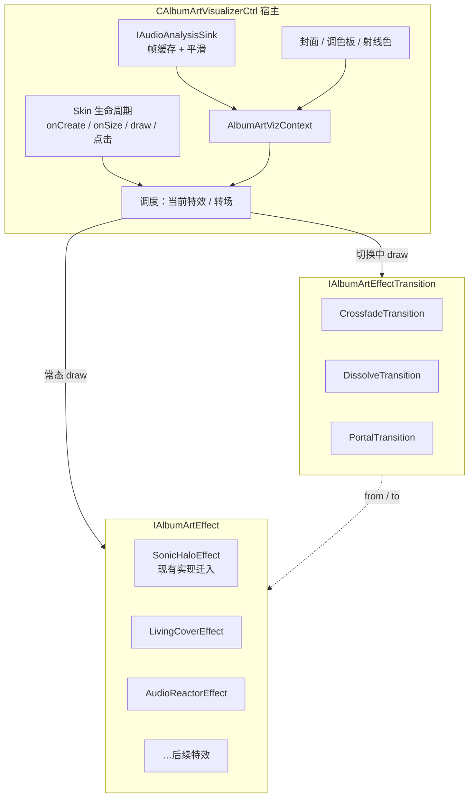
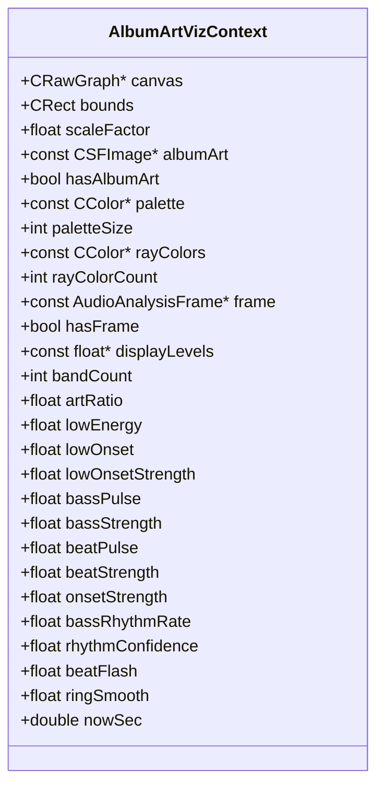
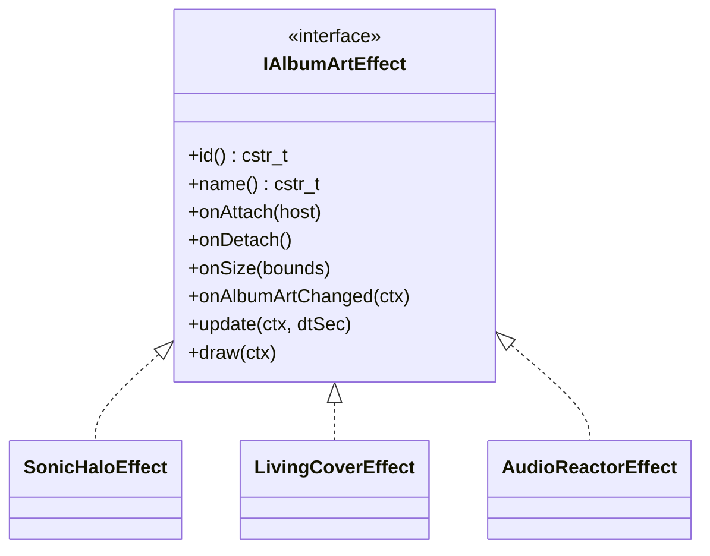
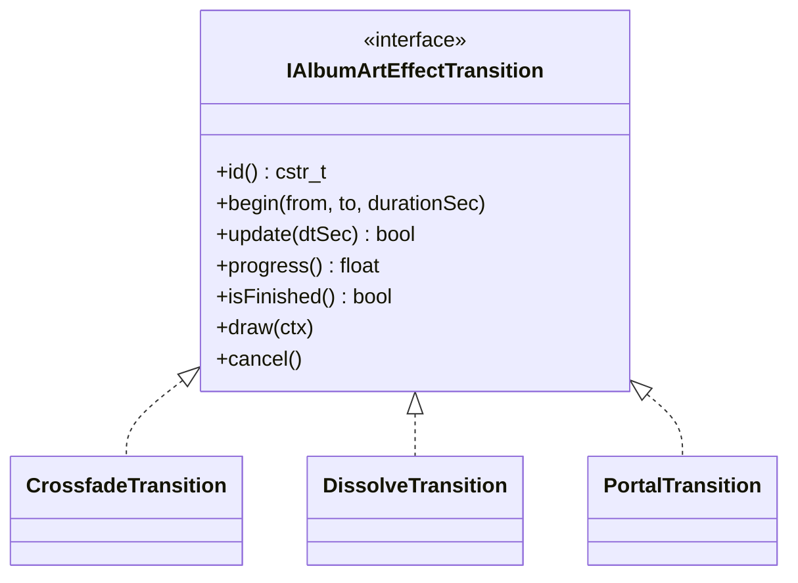
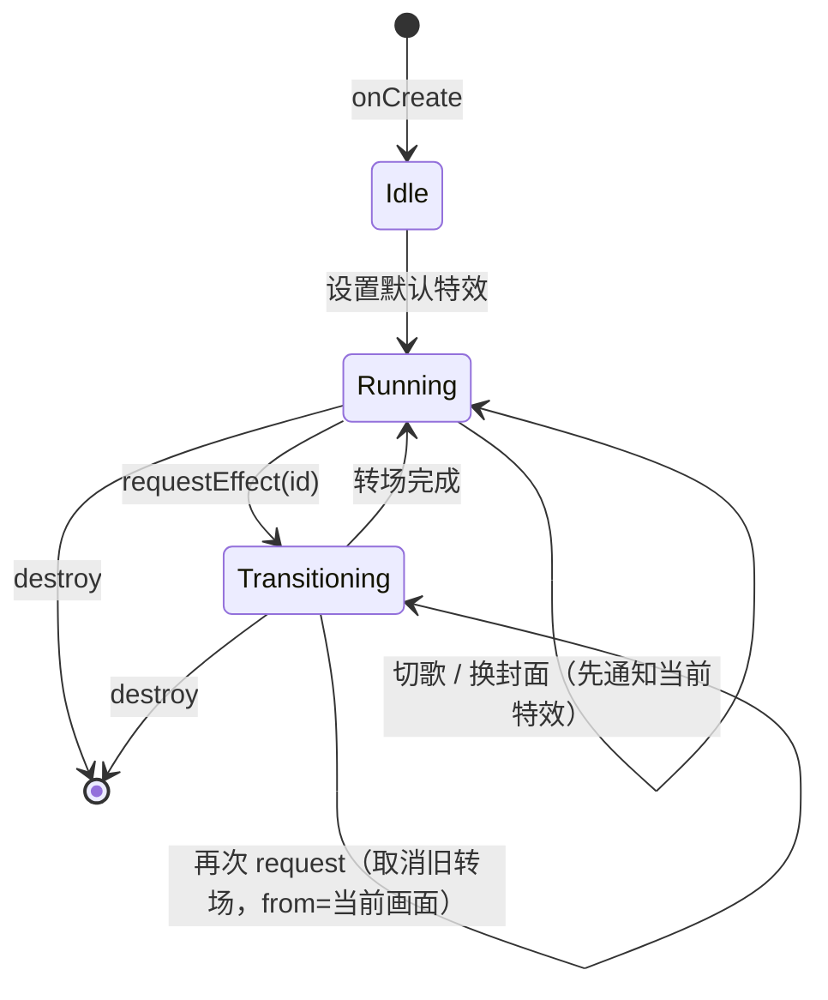
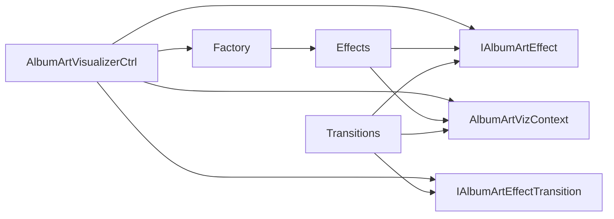

# AlbumArtVisualizer 多特效架构（桌面端）

> 本文是 [album-art-visual-effects.md](album-art-visual-effects.md) 在桌面 Skin 上的**控件架构设计**。目标：把现有单体 `CAlbumArtVisualizerCtrl` 拆成「宿主控件 + 特效插件 + 转场算法」，支持多种封面特效及特效之间的切换。
>
> 本文只定接口与职责边界，不写具体特效算法。产品效果清单仍以封面视觉特效文档为准。

---

## 1. 现状与问题

当前 `MPlayerUI/AlbumArtVisualizerCtrl` 把下列职责揉在一个类里：

- Skin 控件生命周期与属性
- 音频分析订阅与帧缓存
- 封面加载、圆形裁剪、取色 / 射线色
- 频谱平滑与绘制（光环 + 径向条）
- 旋转模式（profile）

要支持 Living Cover、Audio Reactor、Sonic Halo 等多种特效时，再往同一个类里加 `if/else` 会难以维护，也无法独立实现「特效 A → 特效 B」的转场。

---

## 2. 目标

1. **宿主变薄**：`CAlbumArtVisualizerCtrl` 只做 Skin 适配、共享资源、调度。
2. **特效可插拔**：每种视觉效果实现同一接口，可独立增减。
3. **转场可替换**：特效切换（以及后续切歌换封面）走独立转场接口，不写死在某个特效里。
4. **共享输入统一**：所有特效只读同一份可视化上下文（封面、调色板、`AudioAnalysisFrame`、平滑后的频段等）。

非目标（本阶段不做）：

- Web / Three.js（见 `audio-visualization-engine.md`）
- GPU / Shader 路径
- 图层式 Atmosphere/Artwork/Reactive 的完整拆分（可在特效内部先实现）

---

## 3. 总体结构



职责一句话：

| 角色 | 职责 |
| --- | --- |
| `CAlbumArtVisualizerCtrl` | 控件壳：订阅音频、维护封面与调色板、构造 `Context`、调用特效 / 转场 |
| `IAlbumArtEffect` | 一种完整画面风格的更新与绘制 |
| `IAlbumArtEffectTransition` | 两个特效之间（或两份封面状态之间）的过渡绘制 |
| `AlbumArtVizContext` | 特效只读的共享输入，避免每个特效自己拉 Player / 封面 |

---

## 4. 共享上下文

特效与转场**不**直接碰 `g_player` / `CCurMediaAlbumArt`。宿主每帧（或每次 `draw`）填好上下文再传入。



说明：

- 平滑（Attack/Release、peak 下落、脉冲包络）留在宿主，特效吃**已平滑**的数据。
- 节奏字段映射（见 [beat-detection.md](beat-detection.md)）：`lowEnergy`→呼吸/环厚，`bassPulse`/`lowOnset`→Bass 爆发，`beatPulse`→通用闪光，`onsetStrength`→踩镲等细振动；`beatFlash` 兼容等于 `beatPulse`。
- 个别特效需要私有状态（粒子位置、环旋转角）放在特效对象内，不进 `Context`。

---

## 5. 特效接口



建议方法语义：

| 方法 | 何时调用 | 做什么 |
| --- | --- | --- |
| `id` / `name` | 注册与 UI | 稳定 id，如 `"sonic-halo"` |
| `onAttach` / `onDetach` | 成为当前特效 / 被换下 | 申请或释放私有资源 |
| `onSize` | 控件尺寸变化 | 重建离屏缓冲等 |
| `onAlbumArtChanged` | 封面或调色板更新 | 缓存纹理、重采样 |
| `update` | 有分析帧或定时刷新前 | 推进动画状态（可选空实现） |
| `draw` | `CAlbumArtVisualizerCtrl::draw` | 绘制完整一帧（该特效视角下） |

约束：

- `draw` 应能独立画出完整画面（含背景氛围与封面），转场才能对 from/to 各画一帧再合成。
- 特效**禁止**在 `draw` 里订阅/退订音频或改播放状态。
- 工厂：`IAlbumArtEffect *createAlbumArtEffect(cstr_t id)`，未知 id 回退默认特效。

首批特效与产品文档对应：

| id | 说明 | 阶段 |
| --- | --- | --- |
| `sonic-halo` | 现有径向频谱 + 光环迁入（默认） | 已实现 |
| `plain-cover` | 仅封面：原图比例适配控件，不裁成圆形 | 已实现 |
| `living-cover` | 呼吸 + 主色光晕 + 波纹 / 波浪边缘 | Phase A 已实现 |
| `audio-reactor` | 多层频谱环 + Bass 呼吸 + Beat 冲击波 + 轨道微光 | Phase B 已实现 |
| `debug-meters` | 调试柱状图：Bass（lowE/lowOn/bPuls）与通用打击（pulse/btStr）分列 | 测试用 |

---

## 6. 转场接口

特效切换与「切歌换封面」可以共用同一套转场抽象；本阶段先覆盖**特效 ↔ 特效**。



| 方法 | 语义 |
| --- | --- |
| `begin(from, to, durationSec)` | 记录起止特效；`from`/`to` 指针由宿主持有，转场不负责销毁 |
| `update(dtSec)` | 推进进度；返回是否仍在进行 |
| `draw(ctx)` | 通常：让 `from`/`to` 画到临时层或按 progress 混合后输出到 `ctx.canvas` |
| `cancel` | 宿主销毁或强制切特效时立刻结束 |

第一版转场建议只做 **`crossfade`**（透明度交叉），实现成本低，足以验证架构。Dissolve / Portal 后续按产品文档加。

---

## 7. 宿主调度状态



宿主伪代码级流程：

```text
draw():
  build Context
  if transitioning:
      transition->update(dt)
      transition->draw(ctx)
      if finished: current = to; clear transition
  else:
      current->update(ctx, dt)
      current->draw(ctx)

requestEffect(newId):
  if newId == current.id: return
  next = factory(newId)
  next->onAttach / onSize / onAlbumArtChanged
  transition->begin(current, next, 0.5~1.0s)
  state = Transitioning
```

点击行为建议调整：

- **短按 / 手势**：切换特效（走转场），替代或并列于现有「旋转模式」循环。
- **旋转模式**：降为 `sonic-halo` 的本地参数（或长按 / 菜单），避免与「换特效」抢同一点击。

Profile 建议新增键，例如 `AlbumArtVisualizerEffect`，保存当前特效 id。

---

## 8. 文件与依赖建议

```text
MPlayerUI/
  AlbumArtVisualizerCtrl.h/.cpp     # 宿主（变薄）
  albumart-viz/
    AlbumArtVizContext.h            # 共享上下文 POD / 小结构
    IAlbumArtEffect.h
    IAlbumArtEffectTransition.h
    AlbumArtEffectFactory.cpp
    effects/
      SonicHaloEffect.cpp           # 从现有 draw* 迁入
      LivingCoverEffect.cpp         # 后续
      AudioReactorEffect.cpp        # 后续
    transitions/
      CrossfadeTransition.cpp
```

依赖方向：



特效与转场依赖 `GfxRaw` / `AudioAnalysisFrame` / 图像类型，**不**依赖 `CAlbumArtVisualizerCtrl` 具体类（若需要回调，用窄接口 `IAlbumArtVizHost`，仅暴露 `invalidate()` 等）。

---

## 9. 与现有代码的迁移步骤

1. ~~抽出 `AlbumArtVizContext` + 平滑逻辑~~ — 已完成（宿主维护频段 / ring / beat 平滑）。
2. ~~把现有绘制迁入 `SonicHaloEffect`~~ — 已完成。
3. ~~加 Factory + profile 读写特效 id~~ — 已完成（`AlbumArtVisualizerEffect`）。
4. ~~加 `CrossfadeTransition` + `requestEffect`~~ — 已完成；`LivingCoverEffect` 雏形用于点击切换验证。
5. 按 [album-art-visual-effects.md](album-art-visual-effects.md) Phase A/B 补强 Living Cover / Audio Reactor；转场再扩 Dissolve / Portal。

代码目录：`MPlayerUI/albumart-viz/`。皮肤 XML 标签名 `AlbumArtVisualizer` 不变；新增属性 `Effect` / `Transition`；点击循环切换特效。

---

## 10. 接口边界小结

| 需求 | 接口 | 宿主怎么用 |
| --- | --- | --- |
| 具体特效实现 | `IAlbumArtEffect` | 持有 `current`，常态 `update` + `draw` |
| 特效转场算法 | `IAlbumArtEffectTransition` | 切换时 `begin(from,to)`，期间只 `transition->draw` |
| 共享素材与音频 | `AlbumArtVizContext` | 每帧组装后传入特效 / 转场 |
| 创建特效 | `createAlbumArtEffect(id)` | 点击 / 属性 / profile 触发 |

后续若要把「切歌换封面」也做成 Dissolve，可增加：

- `IAlbumArtEffectTransition::beginArtChange(effect, oldArt, newArt)`，或
- 单独的 `IAlbumArtContentTransition`

不必与特效切换共用同一个 `begin` 重载，避免参数含糊；两者可以共享底层混合工具函数。

---

## 11. 相关文档

- [album-art-visual-effects.md](album-art-visual-effects.md) — 效果清单与产品优先级
- [audio-analysis-stream.md](audio-analysis-stream.md) — 分析帧来源
- [web-console/audio-visualization-engine.md](web-console/audio-visualization-engine.md) — Web 侧插件模型（概念相近，实现分离）
