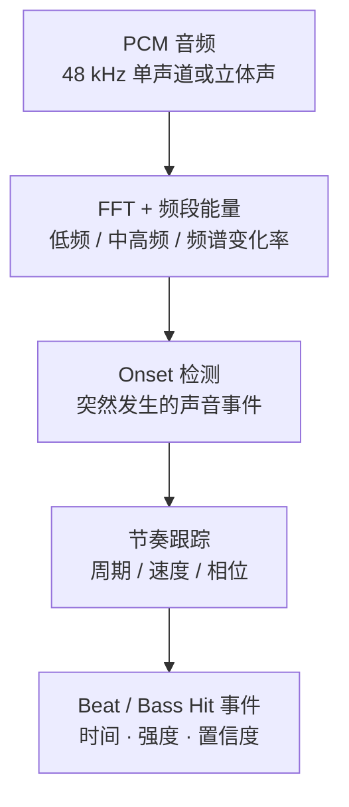
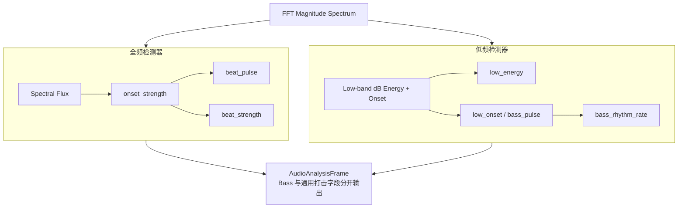
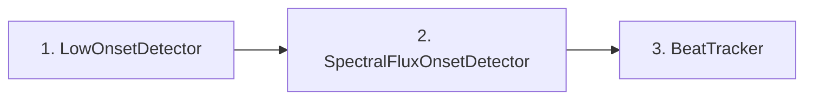

# Beat / 低频打击 / 低频节奏检测

> 本文说明如何为封面特效与 Visualizer 提供**互相独立**的节奏类音频特征：节拍（Beat）、低频起音（Bass Hit / Low-frequency Onset）、低频节奏（Bass Rhythm）。
>
> 分析帧如何从播放端产出并传输，见 [audio-analysis-stream.md](audio-analysis-stream.md)；领域帧字段见 [mplayer-engine.md](mplayer-engine.md) §5.4；封面特效如何消费这些特征，见 [album-art-visual-effects.md](album-art-visual-effects.md)。

---

## 1. 为什么不要只有一个 `beat`

对音乐播放器的视觉特效来说，最好把它们设计成**不同的音频特征**，而不是一个统一的 `beat` 数值。

| 概念 | 含义 | 关注点 |
|---|---|---|
| **Beat detection（节拍检测）** | 判断音乐中的节拍事件何时发生，例如鼓点、拍点 | 时间位置、节奏规律、周期性 |
| **低频打击检测（Bass Hit / Low-frequency Onset）** | 判断低频能量是否突然增强，例如 Kick 的「咚」 | 低频瞬态、能量变化 |
| **低频节奏（Bass Rhythm）** | 描述低频打击出现的时间序列、频率和规律性 | 每秒几次、是否稳定、是否出现连续低频脉冲 |

三者有关联，但**不等价**：

- 踩镲可以产生明显的节拍事件，却没有明显的低频冲击。
- 持续的 Bass 合成器可以有很强的低频能量，却不一定存在清晰的节拍。

对 Audio Reactor、封面呼吸、粒子爆发、光环冲击波等特效，建议至少输出以下特征：

| 特征 | 用途 |
|---|---|
| `beat_pulse` | 节拍瞬间触发光环、闪光 |
| `beat_strength` | 控制每次节拍动画的强弱 |
| `low_energy` | 控制封面呼吸、低频形变 |
| `low_onset` | 检测低频突然冲击，触发 Bass 爆发 |
| `bass_rhythm_rate` | 估算低频脉冲频率 |
| `rhythm_confidence` | 判断节奏规律是否明显 |

核心结论：

> **低频能量**决定画面「有多重」，**低频起音**决定「什么时候撞击」，**Beat Tracking**决定「节奏如何持续」。把这三个维度分开，可视化才会既有冲击力，又不会因为持续低音或高频打击而乱跳。

---

## 2. Beat 检测常见算法

常见思路：先把音频转成随时间变化的特征，再寻找特征中的突变，最后判断突变是否构成稳定节奏。



重要区别：

- **Onset** 是声音事件的开始。
- **Beat** 是音乐节奏中的拍点。

每个 Beat 往往对应某个 Onset，但不是每个 Onset 都是 Beat。例如 120 BPM 时每分钟约有 120 个拍点，但踩镲可能每拍响两次，装饰音也会制造额外 Onset。

### 2.1 算法 A：基于能量突变

最简单：计算相邻帧能量，突然增加就认为可能发生了打击。

短时能量：

\[
E_t = \frac{1}{N}\sum_{n=0}^{N-1} x_t(n)^2
\]

能量增量：

\[
D_t = \max(0,\ E_t - E_{t-1})
\]

当 \(D_t\) 超过自适应阈值时触发事件。

| | |
|---|---|
| **优点** | 计算量小、容易实现 |
| **缺点** | 音量变化、旋律起伏、合成器渐强也可能误触发；难以区分高频打击和低频鼓点 |
| **适合** | 简单音量脉冲效果；**不建议单独作为完整 Beat Detector** |

### 2.2 算法 B：频谱变化率 Spectral Flux（推荐作通用 Onset）

比单纯音量变化更适合复杂音乐。先算 FFT 幅度谱 \(M_t(k)\)，再比较当前帧与上一帧：

\[
\mathrm{Flux}_t = \sum_k \max\bigl(0,\ M_t(k) - M_{t-1}(k)\bigr)^2
\]

其中 \(k\) 是频率 bin。只累加频谱中**增加**的部分，更关注新声音出现，而不是持续存在的声音。

| 场景 | Flux 表现 |
|---|---|
| 鼓点突然出现 | 通常升高 |
| 持续低音（能量大但频谱形状稳定） | 可能很低 |
| 踩镲突然响起 | 可能明显升高 |
| 音乐逐渐变响、频谱形状变化不大 | 不一定很高 |

之后对 Flux 做平滑、算自适应阈值，再峰值检测。这是检测**通用打击事件**的基础算法。

### 2.3 算法 C：Beat Tracking（节拍跟踪）

若要检测的不是任意冲击，而是规律拍点，需在 Onset 之上增加节奏跟踪：

1. 计算 Onset Strength Envelope（打击强度曲线）。
2. 对曲线做自相关，寻找重复周期。
3. 根据周期估算 BPM。
4. 维护节拍相位，预测下一个拍点。
5. 用新检测到的 Onset 修正拍点与相位。

自相关基本形式：

\[
R(\tau) = \sum_t O(t)\,O(t-\tau)
\]

其中 \(O(t)\) 是 Onset 强度，\(\tau\) 是时间延迟。若某个延迟相关性很高，就可能存在重复节奏。例如 120 BPM 对应每拍约 0.5 秒；Onset 若大致按该间隔出现，自相关可能在该延迟附近出现峰值。

实际音乐还有半拍、双倍拍、切分、变速等问题，还需要 BPM 候选选择、相位跟踪和置信度判断。

对视觉特效：完整 Beat Tracking **不一定是第一阶段必需品**。若只是让封面随鼓点闪动，及时、可靠的 Onset 往往比准确估计 BPM 更重要。

---

## 3. 如何检测低频节奏打击感

建议把低频检测做成**单独一条通道**，不要用全频段 Beat 结果代替。

### 3.1 三个低频相关特征

| 特征 | 含义 | 用途 | 注意 |
|---|---|---|---|
| `low_energy` | 低频当前有多强 | 封面呼吸、缩放、背景光晕强度 | 低频持续很强 ≠ 每时每刻都有新鼓点 |
| `low_onset` | 低频能量是否突然增加 | 鼓点爆发、低频冲击波、粒子喷射 | 实现 Bass Hit 的关键指标 |
| `bass_rhythm_rate` | 低频起音的时间间隔与重复规律 | 低频环旋转/扩张节奏；判断鼓点是否稳定 | 是多个 Bass Hit 的时间序列分析，不是单帧 FFT 直接得到 |

### 3.2 推荐算法：低频分带能量 + dB 起音

对每帧 FFT，汇总低频 bin。实现默认约 **40–200 Hz**；边界需按音乐类型调试。

低频功率与对外能量：

\[
E_{\mathrm{low}}(t) = \sum_{k \in B_{\mathrm{low}}} |X_t(k)|^2,\quad
\mathrm{lowEnergy} = \mathrm{clamp}\!\left(\frac{10\log_{10} E_{\mathrm{low}} - L_{\mathrm{floor}}}{L_{\mathrm{ceil}}-L_{\mathrm{floor}}},\,0,\,1\right)
\]

`lowEnergy` 用**固定 dB 区间**映射（勿用「当前能量 / 动态参考」——能量略高于参考会直接饱和到 1）。`L_floor` / `L_ceil` 需按 FFT 幅度标定校准。

起音用相对慢基线的 **dB 增量**（避免基线接近 0 时相对能量比爆炸），并加绝对能量门槛 `minLowEnergyDb`：

\[
N_{\mathrm{dB}}(t) = \max\bigl(0,\ 10\log_{10} E_{\mathrm{low}}(t) - 10\log_{10} E_{\mathrm{slow}}(t)\bigr)
\]

仅当 \(10\log_{10} E_{\mathrm{low}} \ge \mathrm{minLowEnergyDb}\) 且 \(N_{\mathrm{dB}}\) **上穿**自适应阈值 \(\theta_{\mathrm{dB}}\)（且不在 refractory 内）时记为 hit。冲击包络（`lowOnset` / `bassPulse`）**只在 hit 时注入**，不要每帧用连续 `onset` 重新抬起。

实现时还需要：

- 先用上一时刻慢基线算起音，再更新基线（上升慢、下降快）。
- **阈值上穿** + refractory（约 100 ms），避免连续多帧重复触发。
- 连续起音强度可另出 `lowOnsetStrength`，与离散冲击包络分开。

注意：40–200 Hz 只是实用起点，不能完美区分 Kick 与 Bass。若中频纯音仍抬高 `lowEnergy`，再查 FFT 索引/窗泄漏，必要时加大低频 FFT 窗口。

---

## 4. 两条检测通道如何组合

`AudioAnalyzer` 内部建议用两套检测器，**共享同一个 FFT 结果**：



典型场景：

| 音乐场景 | Beat / Onset | 低频冲击 | 建议视觉效果 |
|---|---|---|---|
| 重低音 EDM | 强 | 强 | 封面缩放 + 爆发波 |
| 踩镲主导的节奏 | 强 | 弱 | 高频闪光、细线振动 |
| 持续低音 Pad | 弱 | 可能持续较强 | 缓慢呼吸，不反复爆发 |
| 摇滚鼓组 | 强 | 强或中等 | 光环脉冲 + 低频形变 |
| Ambient | 较弱或不规律 | 较弱 | 平滑渐变、粒子缓慢漂移 |

---

## 5. V1 建议输出字段

不要只保留一个 `beat`。可在领域帧上扩展（或并行产出）以下字段；归一化范围由分析器统一定义：

```cpp
struct AudioAnalysisFrame {
    // 原有：sessionId / sequence / samplePosition / sampleRate
    // 原有：rms / peak / bass / mid / treble / bands ...

    // 通用起音 / 打击（约 80–3000Hz Spectral Flux，可含中频）
    float onsetStrength;    // 全频起音强度，连续值
    float beatPulse;        // 通用打击脉冲，0..1
    float beatStrength;     // 最近一次通用打击强度，0..1

    // 低频专属（约 40–200Hz）
    float lowEnergy;          // 固定 dB 范围映射的低频能量，0..1
    float lowOnsetStrength;   // 连续低频起音（调试/插值）
    float lowOnset;           // 仅 hit 触发的低频冲击包络
    float bassPulse;          // 仅低频 hit 的脉冲（封面缩放等）
    float bassStrength;       // 最近一次低频冲击强度
    float bassRhythmRate;     // 低频事件频率估计 Hz（≠ BPM）
    float rhythmConfidence;   // 节奏规律置信度，0..1
};
```

实现注意：

| 字段类型 | 行为 |
|---|---|
| `onsetStrength` / `lowEnergy` / `lowOnsetStrength` | **连续值**，可用于动画插值 |
| `beatPulse` / `bassPulse` / `lowOnset` | **瞬态脉冲**：仅事件命中时冲顶，再按时间常数衰减 |
| `bassRhythmRate` / `rhythmConfidence` | **较慢更新**的节奏统计，不应每个 FFT 帧都重算 |
| 更准确的拍点预测 | 另做独立 `BeatTracker`，不要把节奏跟踪塞进 FFT 类 |

实时参数建议（与 [mplayer-engine.md](mplayer-engine.md) §5.5 一致）：

- FFT size：2048
- Hop size：1024
- 分析更新率：约 30–50 Hz（对外可用 `outputRate` 限流）

检测到的瞬态通过时间戳与音频播放位置对齐；Web 端 60 FPS 渲染时，再对连续特征插值。

与现状的关系：`beat` 兼容等于 `beatPulse`。`beatPulse` 仅由 **80–3000Hz Flux hit** 驱动；`bassPulse` / `lowOnset` 仅由 **LowOnset hit** 驱动，二者不再合并。完整 `BeatTracker` 另做。

实现要点（Analyzer）：

- **每个 hop 都 FFT + Onset**；`outputRate` 只限制发布频率，不跳过分析窗。
- **`samplePosition` = 分析窗中心**（`windowStart + fftSize/2`）。
- **`lowEnergy`**：40–200Hz 线性功率 → 固定 dB 区间映射（默认约 -55..-6 dB，需按 FFT 标定校准）。
- **`LowOnset`**：相对慢基线的 **dB 上升** + `minLowEnergyDb` 门槛；阈值上穿触发 hit；包络只在 hit 时注入。
- 频带平滑与慢基线使用 **时间常数**（不随帧率绑死）。

---

## 6. 推荐开发顺序



1. **`LowOnsetDetector`**：最容易直观看出效果，直接驱动 Audio Reactor 的低频冲击。
2. **`SpectralFluxOnsetDetector`**：检测全频起音，让踩镲、军鼓等也能触发动画。
3. **`BeatTracker`**：估算 BPM、节拍相位与置信度，用于更有规律的动画同步。

三个模块应**独立测试**，用不同音乐样本检查误触发、漏检和延迟。不要指望一开始用单个阈值适配所有音乐类型。

### 实现现状

| 模块 | 状态 | 代码位置 |
|---|---|---|
| `LowOnsetDetector` | 已接入：固定 dB `lowEnergy` + dB 起音 + 绝对能量门槛；阈值上穿 hit | `MPlayerEngine/analysis/LowOnsetDetector.h` |
| `SpectralFluxOnsetDetector` | 已接入：对数幅度半波 Flux + 峰值检测（80–3000Hz） | `MPlayerEngine/analysis/SpectralFluxOnsetDetector.h` |
| `BassRhythmEstimator` | 轻量间隔估计（非完整 Beat Tracking） | `MPlayerEngine/analysis/BassRhythmEstimator.h` |
| `BeatTracker`（BPM / 相位预测） | **未做**；`beatPulse` 仅由 Flux 脉冲代理，`bassPulse` 仅由 LowOnset | — |

约束：不引入 aubio / Essentia 等大型库；检测复用已有 FFT 幅度谱，在 Analyzer 产出帧路径上运行（约 `outputRate` Hz）。

---

## 相关文档

- [audio-analysis-stream.md](audio-analysis-stream.md) — 播放端分析来源与传输
- [mplayer-engine.md](mplayer-engine.md) — Analyzer 线程、`AudioAnalysisFrame`、FFT/Hop/OutputRate
- [album-art-visual-effects.md](album-art-visual-effects.md) — 封面特效如何映射 Bass / Beat
- [album-art-visualizer-architecture.md](album-art-visualizer-architecture.md) — 桌面封面可视化架构
- [audio-visualization-engine.md](web-console/audio-visualization-engine.md) — Web Visualizer 与 Beat 驱动接口
